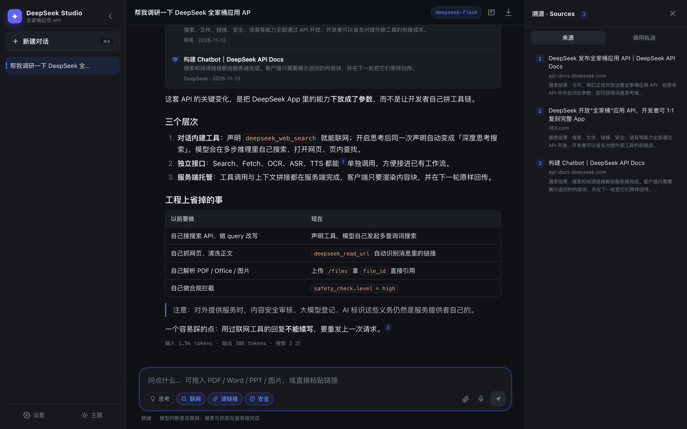

# DeepSeek Studio

一个把 **DeepSeek「全家桶应用 API」**（2026-11-13 发布）用到底的本地工作台：
联网搜索、深度思考搜索、文件解析、阅读链接、模型内容安全、语音输入与朗读，
全部走官方 API；界面按官方文档的内容块语义逐块渲染，并额外做了跨轮次的可溯源面板。

**线上地址**：https://gitdawei.github.io/deepseek-studio/ （GitHub Pages，纯静态，打开后填自己的 API Key 即可用）



> 官方 Demo 是「能跑」，这个项目想做的是「能用」：把搜索结果、抓取网页、正文引用
> 统一编号沉淀成一份可导出的参考文献，并显式暴露工具开关、安全等级与用量。

---

## 一、调研结论：这次 API 到底开放了什么

发布日期 **2026/11/13**，官方叫「全家桶应用 API」。核心变化不是出了新模型，
而是把 DeepSeek App 里的交互能力**下放成了参数**：以前要自己拼搜索 API + 网页抓取 +
文档解析 + 合规拦截，现在开几个字段，服务端替你做完上下文拼接。

| 能力 | 开启方式 | 说明 |
| --- | --- | --- |
| 联网搜索 | 声明 `deepseek_web_search` + 关闭思考 | 模型自己判断是否搜，一次调用可带多个查询词，回答带引用 |
| 深度思考搜索 | 同一工具 + 开启思考 | 多步推理中自主 `search` / `open_page` / `find_in_page`，约 20 次工具调用后作答 |
| 阅读链接 | 声明 `deepseek_read_url` | 自动识别**最后一条用户消息**里的 URL（最多前 10 个）并抓取 |
| 文件输入 | `POST /files` 拿 `file_id`，再在消息里引用 | 上传时即完成解析，支持 PDF/Office/图片 |
| 模型内容安全 | `safety_check: {level: "high"}` | 审核输入与输出，命中返回 `stop_reason: "refusal"` |
| 用户元信息 | `role: "latest_reminder"` 消息 | 格式 `日期,星期,所在地,平台,语言`，须紧跟 user 消息 |
| 会话标题 | `title: {enabled: true}` | 标题在 `message_delta.delta.title` 里回来 |

**协议**：Messages（`/anthropic/v1/messages`）、Responses（`/responses`）、
Chat Completions（`/chat/completions`）三套都支持，模型必须是 `deepseek-flash`（V4.1-Flash）。

**独立工具 API**（可脱离对话单独调）：

| 接口 | 用途 | 计费 |
| --- | --- | --- |
| `POST /v1/tools/search` | 网页搜索，支持 `site:` / `after:` / `lang:` 等语法 | 5 元 / 1000 次 |
| `POST /v1/tools/fetch` | 网页抓取，返回 Markdown 正文 | 5 元 / 1000 次 |
| `POST /v1/tools/ocr` | OCR，逐页文本 + 版面坐标 | 1.5 元 / 1000 页 |
| `POST /v1/tools/tts` | 语音合成，返回音频流（wav/pcm） | 3 元 / 万字符（汉字算 2） |
| `POST /v1/tools/asr` | 语音识别，只收 16-bit PCM WAV / Ogg Opus | 0.78 元 / 小时 |

### 踩过的坑（都已在代码里处理）

1. **带引用后正文会被切断。** 一个 `text` 块带上引用后，服务端会把后续正文放进
   **新的 `text` 块**。逐块渲染会把列表、表格拦腰截断 —— 必须把相邻 `text` 块拼成
   一份 Markdown 再渲染。
2. **拒答不能撤回。** 已经流式下发的文本收不回来，但 `stop_reason: "refusal"` 要求
   删掉已展示的回答、换成自己的拒答文案；而且服务端会在输出结束后再审核一次，
   连接不会立即关闭。
3. **历史必须原样回传。** `signature` 和 `kind` 是加密上下文的载体，尤其是
   `deepseek_read_url` 抓到的网页正文只存在 `signature` 里，丢了就再也拼不回上下文。
4. **`purpose` 必须写在 `file` 之前**，否则 400。
5. **用过联网工具的回复不能续写**，会直接 400，要重发上一次请求。
6. **`/files` 解析完才返回响应**，期间不传任何数据，客户端和代理超时都要放大。
7. **开了工具或安全校验后，一批采样参数被服务端接管**：`temperature`、`top_p`、
   `top_k`、`stop_sequences`、`thinking.budget_tokens` 等传入会被忽略。

---

## 二、快速开始

```bash
cd deepseek-studio

# 方式 A：服务端注入 Key（推荐，浏览器不用填）
DEEPSEEK_API_KEY=sk-xxxx npm start

# 方式 B：不带环境变量，启动后在页面「设置」里粘贴 Key（只存 localStorage）
npm start
```

打开 http://127.0.0.1:8787 。

> 需要 Node ≥ 20（用到全局 `fetch`，验证脚本用到全局 `WebSocket`，建议 22）。
> **零依赖**，不需要 `npm install`。

### 不花 token 地调试

内置一个 Mock 上游，完整复刻 SSE 事件序列（思考 → 搜索 → 结果 → 带引用正文 → 用量）：

```bash
node dev/mock-api.mjs                                  # 终端 A，监听 8899
DEEPSEEK_BASE_URL=http://127.0.0.1:8899 npm start      # 终端 B
```

### 真机冒烟

```bash
DEEPSEEK_API_KEY=sk-xxxx node dev/smoke.mjs
```

会真实打一次「联网搜索 + 安全校验 + 会话标题」请求，逐条打印事件与内容块，
并校验关键字段是否存在。

---

## 二·五、部署

DeepSeek 的 API 对浏览器**完全放开了 CORS**（预检会原样回显
`content-type,authorization,x-api-key,anthropic-beta`），所以不需要任何后端，
`dist/` 扔到任意静态托管就能跑：

```bash
npm run build     # 产出 dist/，并写入 config.js 指向 api.deepseek.com
```

| 目标 | 做法 |
| --- | --- |
| **GitHub Pages**（当前） | `./dev/push-github.sh gitdawei/deepseek-studio` |
| Cloudflare Pages | `./dev/deploy-cf.sh`（需 API Token 或先 `wrangler login`） |
| Vercel | `vercel --prod`，Framework 选 Other，Output Directory 填 `dist` |
| Netlify | `netlify deploy --prod --dir=dist`，配置见 `netlify.toml` |

`push-github.sh` 会把源码推到 `main`、把构建产物推到 `gh-pages`，并带一个
`.nojekyll`（否则 Jekyll 会吞掉 `_` 开头的文件）。

> **子路径托管的坑**：GitHub Pages 项目站挂在 `/<repo>/` 下，所有资源必须用
> **相对路径**（`app.js` 而不是 `/app.js`），否则脚本全部 404、页面白屏。
> 这个问题只有在部署完之后才暴露，已在 `index.html` 与 `build.mjs` 中修正。

两种运行模式前端自动识别，同一份代码不用改：

| 场景 | 请求路径 | Key 来源 |
| --- | --- | --- |
| `npm start` 本地跑 | `/api/*` → `server.mjs` 代理 | 环境变量或页面设置 |
| 纯静态托管 | 浏览器直连 `api.deepseek.com` | 只能页面设置（localStorage） |

静态部署**不要**把 Key 写进任何文件 —— 页面里填的 Key 只存在访客自己的浏览器，
不会上传到服务器，也不会出现在仓库里。

---

## 三、功能

**对话**
- 流式输出，可随时停止；`思考` / `联网` / `读链接` / `安全` 四个开关实时切请求参数
- 思考过程可折叠，标题会显示「已深度思考（用时 N 秒）」
- 搜索结果卡片：查询词 chips、站点图标、标题、摘要、日期
- 正文引用角标 `¹²³`，点击定位到右侧来源
- 逐条用量：输入 / 输出 / 缓存命中 token、搜索与抓取次数、安全审核 token
- 拒答与错误分别有独立样式；重新生成、复制、朗读

**文件**
- 拖拽或选择上传，先 `POST /files` 解析（`purpose` 在前），拿到 `file_id` 再引用
- 支持 PDF / Word / PPT / 图片 / txt / md / csv / xlsx / epub
- 解析方式可选「图文混排」（能看图表）或「纯文本」（更省 token）

**语音**
- 麦克风录音 → 浏览器内解码 → 重采样成 16kHz 单声道 WAV（ASR 只认这个）→ 识别回填
- 朗读回答：TTS 返回音频流，stella / tide 两种音色

**其他**
- 会话列表、自动标题、重命名、删除
- 溯源面板：来源清单 + 调用轨迹两条视图，跨整轮会话累计编号
- 导出当前对话为 Markdown（含参考文献）、全量导入导出 JSON
- 深色 / 浅色主题、窄屏适配、⌘K 新建、`/` 聚焦输入框

---

## 四、结构

```
deepseek-studio/
├── server.mjs            零依赖本地服务：静态托管 + /api/* 反向代理
│                         （SSE 不缓冲、multipart 直通、服务端注入 Key）
├── public/
│   ├── index.html        三栏骨架
│   ├── styles.css        设计系统 + 响应式
│   ├── md.js             自包含 Markdown 渲染器（先转义再解析，支持表格/代码/引用角标）
│   └── app.js            状态、SSE 解析、内容块渲染、上传、语音、导出
└── dev/
    ├── mock-api.mjs      Mock 上游（含拒答、500 两条异常路径）
    ├── drive.mjs         无头 Chrome + CDP 截图验证
    └── smoke.mjs         真机 API 冒烟
```

为什么要有 `server.mjs`：DeepSeek 的 `/anthropic` 接口没开放浏览器跨域，
而且不该把 Key 摆在页面里。代理层顺手解决 SSE 缓冲、大文件上传超时和 Key 注入。

---

## 五、验证过什么

用 Mock 上游 + 无头 Chrome（`dev/drive.mjs`）逐项截图确认：

- 空态、流式生成、思考折叠、搜索卡片、引用角标、表格/列表/引用块渲染
- 溯源面板编号与正文角标一致
- 浅色主题对比度、420px 窄屏布局
- 错误路径（HTTP 500）与拒答路径（先流出文本再被拒答 → 文本被移除）
- multipart 上传、TTS 返回 `audio/wav`、ASR 返回文本
- 相邻 `text` 块合并（列表不再断成两截）
- XSS：模型输出中的 `<script>` / `` 均被转义（`md.js` 先转义再解析）

线上部署后又单独验证了一次跨域：从 `https://deepseek-studio.netlify.app` 发起请求，
带上自定义 `x-api-key` 头，DeepSeek 返回的是真实业务错误
（`Your api key: **** is invalid (request_id: ...)`）而不是 `Failed to fetch` ——
说明预检通过、自带请求头被放行，纯静态方案成立。

---

## 六、已知限制

- 未实现「继续生成」：用过联网工具的回复本就不可续写，且 Responses API 不支持。
- 对话存在 localStorage，超长文档历史可能撑爆配额（会提示且不丢当前会话）。
- 语音识别受浏览器 `MediaRecorder` 支持影响；Safari 走 mp4 → 本地解码成 WAV。
- 计费只展示用量，不做金额换算（单价会变，且缓存命中价不同）。
- 未做多用户 / 服务端会话：这是一个本地工具，不是 SaaS。
